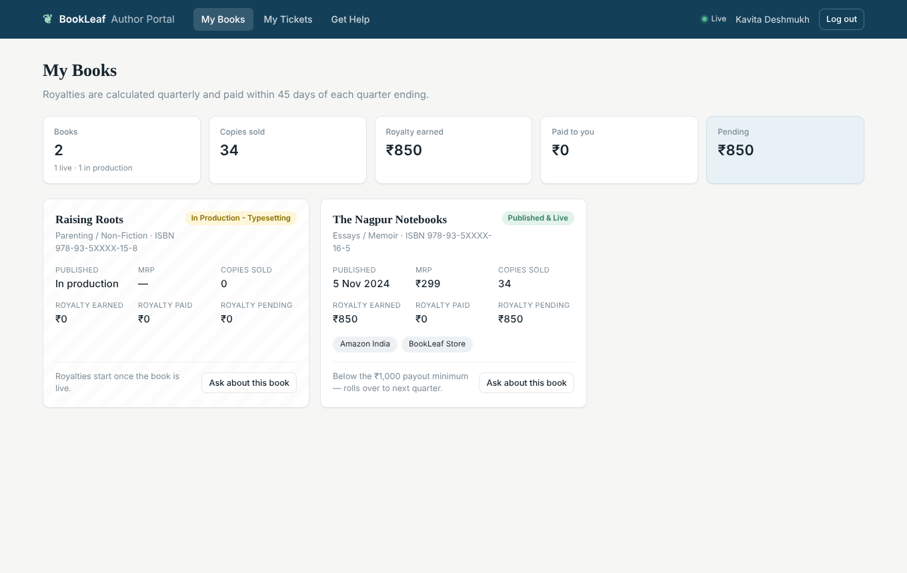
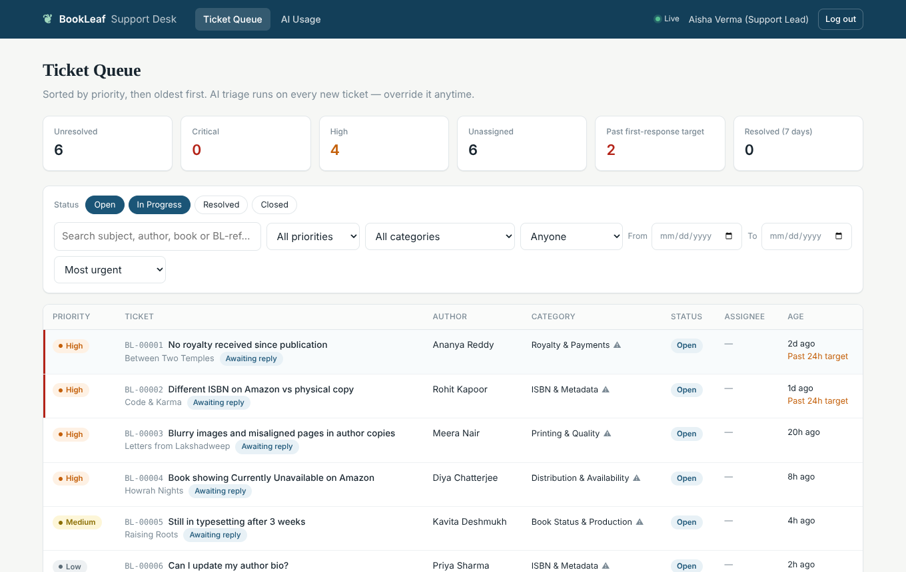
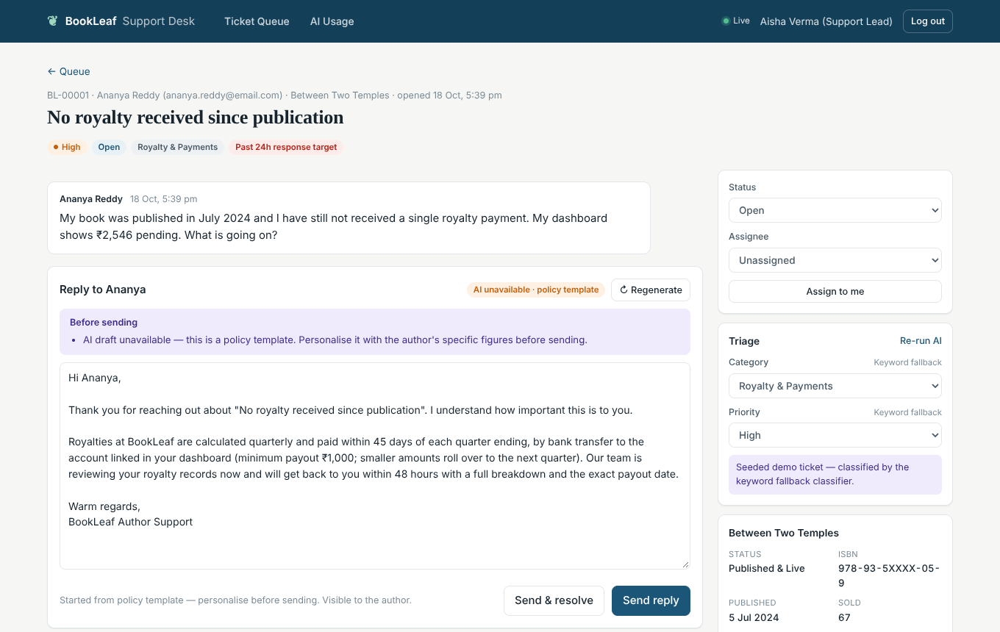
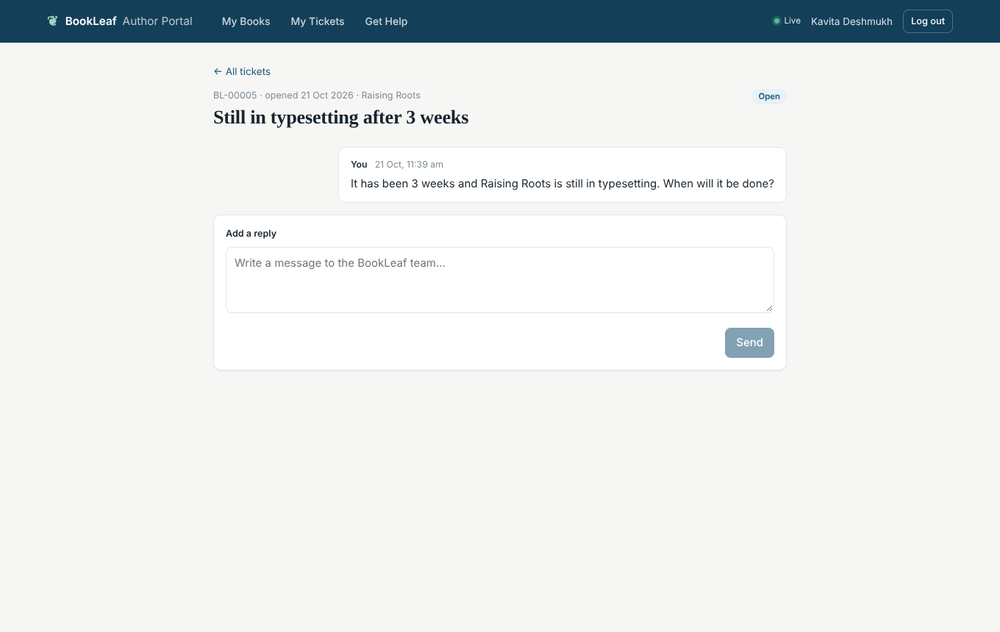

# BookLeaf — Author Support & Communication Portal

A web app with two interfaces — an **Author Portal** and an **Admin Support Desk** — where AI triages every incoming ticket and drafts a policy-accurate reply for a human agent to review and send.

**Stack:** React 19 (Vite) · Node.js / Express 5 · PostgreSQL · Anthropic Claude (Haiku) · Server-Sent Events

> **Live demo:** _add your deployed URL here_ · **API docs:** `<demo-url>/api/docs` · **Write-up:** [WRITEUP.md](WRITEUP.md)

### Test logins

| Role | Email | Password |
|---|---|---|
| Admin (Support Lead) | `admin@bookleaf.com` | `Admin@123` |
| Admin (Operations) | `ops@bookleaf.com` | `Admin@123` |
| Any of the 10 authors | e.g. `ananya.reddy@email.com`, `sneha.kulkarni@email.com`, `kavita.deshmukh@email.com` | `Author@123` |

Every author email in `bookleaf_sample_data.json` works with `Author@123`. Useful edge cases: **Ananya** (royalty never paid, ₹2,546 pending), **Sneha** (3 books, one in Cover Design), **Kavita** (one book in Typesetting, one with ₹850 pending — below the ₹1,000 payout threshold), **Rohit** (high earner, payouts lagging). The queue is pre-seeded with six tickets modelled on the brief's sample queries.

| Author: My Books | Admin: Ticket Queue |
|---|---|
|  |  |
| **Admin: ticket with draft, triage, book snapshot** | **Author: live ticket thread** |
|  |  |

<sub>Screenshots were taken with no API key configured, so they also show the degraded mode: keyword triage and a policy-template draft.</sub>

---

## Contents
1. [Running locally](#1-running-locally)
2. [Architecture](#2-architecture)
3. [AI integration](#3-ai-integration)
4. [API](#4-api)
5. [Product decisions & edge cases](#5-product-decisions--edge-cases)
6. [Testing](#6-testing)
7. [Deployment](#7-deployment)
8. [Assumptions, limitations & next steps](#8-assumptions-limitations--next-steps)

---

## 1. Running locally

**Option A — Docker (one command)**
```bash
echo "ANTHROPIC_API_KEY=sk-ant-..." > .env   # optional; the app works without it
docker compose up --build                    # → http://localhost:4000
```

**Option B — Node 20+ and a local PostgreSQL**
```bash
# 1. Database
createuser -P bookleaf          # password: bookleaf
createdb -O bookleaf bookleaf
createdb -O bookleaf bookleaf_test   # only needed for tests

# 2. Config
cp server/.env.example server/.env   # set ANTHROPIC_API_KEY (optional)

# 3. Install, migrate, seed
npm run install:all
npm run setup:db                     # migrations + seed from server/data/bookleaf_sample_data.json

# 4. Run (two terminals)
npm run dev:server                   # API on :4000
npm run dev:client                   # UI on :5173 (proxies /api to :4000)
```
The server also migrates and seeds itself on boot (idempotent), so a fresh database is ready with zero manual steps. `npm --prefix server run seed -- --reset` wipes tickets and restores the demo queue.

**Without an API key** the app runs fully: new tickets get keyword-based triage and admins get policy-template drafts (clearly labelled). Add the key to switch on Claude.

---

## 2. Architecture

```
 React SPA ── REST (JWT) ──▶ Express API ──▶ PostgreSQL
     ▲                        │   │
     └──── SSE /api/events ───┘   └──▶ AI layer ──▶ Anthropic Messages API
                                        (classifier, drafter, circuit breaker, call log)
```
In production a single Express service serves both the API and the built React app (one URL, no CORS, one thing to deploy).

```
server/src
├── config/        env.js (all secrets read here, validated), constants.js (categories/priorities/statuses)
├── db/            pool, forward-only SQL migrations, migrate + seed scripts
├── middleware/    auth (JWT + role gate), validate (zod), upload (multer), errorHandler
├── validators/    zod schemas for every request body/query
├── routes/        thin HTTP layer: auth, books, tickets (author), admin, events (SSE)
├── services/      business logic: ticketService, bookService, aiService (orchestration), events (pub/sub)
└── ai/            provider.js (only place the API key is used), classifier, drafter,
                   prompts/, knowledgeBase.js (sectioned KB), accountFacts.js, ruleClassifier.js
client/src
├── api/           fetch wrapper (error envelope → ApiError), SSE-over-fetch client
├── auth/ hooks/   session context, shared live-events provider, useAsync
├── components/    Layout, Thread, badges, formatters
└── pages/         author/ (books, new ticket, tickets, ticket) · admin/ (queue, ticket, AI usage)
```

**Key decisions**

| Decision | Why |
|---|---|
| **Express + plain SQL (`pg`)** over an ORM | The schema is small and queries like the urgency-sorted queue with lateral joins are clearer in SQL. Every query is parameterised. |
| **PostgreSQL** | Relational data (authors → books → tickets → messages), check constraints enforce valid statuses/categories at the DB level, arrays for `available_on`, JSONB for draft checklists. |
| **Routes → services → db** | Routes only parse/validate and call a service. All access rules (who may see which ticket) live in `ticketService`, so they can't be forgotten in one route. |
| **Server-Sent Events** for real time | Updates are one-directional (server → client). SSE is plain HTTP, auto-reconnects and works through proxies — simpler than WebSockets. The client reads the stream with `fetch()` so the JWT stays in the `Authorization` header instead of the URL. Events carry only ids; clients refetch, so the API stays the single source of truth and RBAC applies. |
| **AI runs outside the request path** | Ticket creation returns immediately; triage runs in the background. Drafts load in a separate request, so the ticket page renders instantly. |
| **Audit trail table** | Every status change, override, assignment and AI result is recorded in `ticket_events` and shown on the ticket — useful for accountability and for measuring AI accuracy (how often admins override). |

**Data model** (`server/src/db/migrations/001_initial_schema.sql`): `authors`, `books`, `users` (author accounts link to an author; admins don't), `tickets` (category/priority each carry a `*_source` of `ai | rules | admin`), `ticket_messages` (author-visible thread), `internal_notes` (admin-only), `ticket_events` (audit), `ai_drafts` (cache), `ai_calls` (token/latency/error log).

---

## 3. AI integration

### Model choice — Claude Haiku (`claude-haiku-5-5`, configurable via `AI_MODEL`)
Both tasks — classifying a short ticket and writing a ~200-word, policy-grounded reply — are well within a small model's ability, and support traffic is high-volume and latency-sensitive (an agent waits for the draft). Haiku is Anthropic's fastest, cheapest tier, it supports forced **tool use** (reliable structured output) and **prompt caching**. Swapping in a larger model for drafts only is a one-line env change if quality ever needs it.

### Two AI features, two different prompts

**1. Triage (category + priority) — one call, on ticket creation**
- One call returns both category and priority (half the cost of two calls).
- The prompt contains category definitions and a priority rubric derived from BookLeaf policy (e.g. *ISBN errors are always at least High*, *6+ months unpaid is Critical*) — **not** the knowledge base, which classification doesn't need. ~600 tokens per call, `max_tokens: 200`.
- The model must call a `classify_ticket` tool whose schema uses enums, and the result is validated again with zod. Anything off-schema is treated as a failure.
- A short book-status line is included, so "my book has no sales" on a book still in production is triaged correctly.
- AI never overwrites a human: if an admin has overridden category/priority, a late or re-run classification leaves it alone (`*_source = 'admin'`).

**2. Draft reply — on demand, when an admin opens a ticket**
The prompt is assembled per ticket (`server/src/ai/prompts/draft.js`; a full real example is in [docs/ai-prompt-example.md](docs/ai-prompt-example.md)):

| Part | Content | Why |
|---|---|---|
| System (cached) | Persona, BookLeaf tone guidelines verbatim, writing rules (structure, sign-off, "only use facts provided", no filler phrases, never blame the author) | Identical every call → marked `cache_control` |
| `<policy>` | **Only the KB sections for this ticket's category** (e.g. royalty tickets get the Royalty Policy, not Printing) | Grounding + token savings |
| `<calibration_examples>` | The brief's sample query→response guidance for this category only | Few-shot tone calibration |
| `<account_facts>` | A facts sheet **computed in code** (below) | Specific numbers, no hallucinated maths |
| `<conversation>` | Last 6 messages, each truncated to 1,500 chars, marked as author content (not instructions) | Bounded cost, prompt-injection hygiene |

**Account facts are computed deterministically, not by the LLM** (`accountFacts.js`): today's date, the next payout deadline (quarter end + 45 days), pending vs the ₹1,000 threshold, days since last payout, an explicit **OVERDUE flag** when money above the threshold has gone unpaid for more than a full cycle, and for in-production books the current stage, step *n* of 9 and remaining stages. This is what lets drafts say *"your Q3 royalties are due by 14 November"* or *"₹850 is below the ₹1,000 minimum, so it rolls over"* correctly — LLMs are unreliable at date arithmetic, code isn't.

The draft tool returns the reply **plus an `admin_checklist`** — things the agent should verify before sending (e.g. *"Confirm bank details are linked"*, *"Raise re-sync with distribution"*). The model is told to put unknowns there rather than guess, which is how it handles facts the dataset doesn't have (per-platform sales splits, bank-link status).

### Error handling & graceful degradation
| Failure | Behaviour |
|---|---|
| No API key | Keyword triage (`ruleClassifier.js`) + policy-template drafts. Everything else works. |
| Timeout / 429 / 5xx | SDK retries with backoff (`AI_MAX_RETRIES=2`, `AI_TIMEOUT_MS=15000`), then falls back. |
| Repeated failures (outage) | **Circuit breaker:** after 3 consecutive failures, AI calls are skipped for 60 s and fallbacks are used immediately, so tickets don't each wait for a timeout. |
| Malformed model output | Rejected by zod → fallback. |
| Any of the above | The ticket is **always** created (it gets keyword triage synchronously, before any AI call). Fallback results are labelled in the UI ("Keyword fallback", "AI unavailable · policy template") so agents know to review them. Template drafts aren't cached, so the next open retries the AI. |

### Cost awareness
- **Never the whole KB, never the whole history:** classification sends no KB; drafts send 1–3 relevant KB sections and at most 6 truncated messages. A typical draft request is ~1,200 input tokens — roughly half of sending the full KB, all examples and every book each time — and it stays flat as threads grow instead of increasing with every message.
- **Draft cache:** a draft is stored with the thread length it was generated for. Re-opening a ticket (by the same or another agent) reuses it — **zero tokens** — until the conversation changes. "Regenerate" forces a new one.
- **Prompt caching** markers on the static system prompts. Today those prompts are shorter than the provider's minimum cacheable length, so this is effectively a no-op; it starts paying off automatically if the static prefix grows (e.g. more examples or the full KB moved into the system prompt).
- **Tight `max_tokens`** (200 triage / 700 draft), temperature 0 for triage.
- **Observability:** every call is logged to `ai_calls` (tokens in/out, cache reads, latency, error). The admin **AI Usage** page shows calls, failures, estimated spend and the share of replies started from an AI draft — the metric that tells you whether the drafts are actually useful.

### Security
- The key is read only from `ANTHROPIC_API_KEY` in `config/env.js` and used only in `ai/provider.js`. It's never sent to the browser, logged, or committed (`.env` is git-ignored; `.env.example` has no secrets). The browser only ever calls our API.
- Author-written text is wrapped in tagged blocks the prompt declares as author content; tool-forced output means a prompt-injected ticket can at worst produce an odd draft, which a human reviews before sending.

---

## 4. API

Full OpenAPI 3 spec: [`server/docs/openapi.yaml`](server/docs/openapi.yaml), browsable with Swagger UI at **`/api/docs`** on the running app.

Conventions: JSON everywhere, `Authorization: Bearer <JWT>` on everything except login/health, plural resource nouns, sub-resources for actions on a ticket, and one error envelope:
```json
{ "error": { "code": "BAD_REQUEST", "message": "Validation failed",
             "details": [{ "field": "subject", "message": "Subject must be at least 5 characters" }] } }
```
Status codes: `400` validation · `401` unauthenticated/expired · `403` wrong role · `404` not found **or not yours** (authors can't probe other authors' ticket ids) · `409` conflicting state (e.g. replying to a closed ticket) · `429` login rate limit · `500` only for genuinely unexpected errors (DB constraint violations are mapped to 4xx).

| Method | Path | Role | Purpose |
|---|---|---|---|
| POST | `/api/auth/login` | public | Email + password → JWT (rate-limited) |
| GET | `/api/auth/me` | any | Current user |
| GET | `/api/books` | author | My books + totals |
| GET | `/api/books/:bookId` | author | One of my books |
| GET | `/api/tickets` | author | My tickets |
| POST | `/api/tickets` | author | Raise ticket (JSON or multipart with optional `attachment`) |
| GET | `/api/tickets/:id` | author | My ticket + public thread |
| POST | `/api/tickets/:id/messages` | author | Follow-up (re-opens a resolved ticket) |
| GET | `/api/tickets/:id/attachment` | owner / admin | Download attachment |
| GET | `/api/admin/tickets` | admin | Queue: `status, priority, category, assignee, from, to, q, sort, limit, offset` |
| GET | `/api/admin/tickets/stats` | admin | Queue counters |
| GET | `/api/admin/tickets/:id` | admin | Ticket + book snapshot + notes + audit trail |
| PATCH | `/api/admin/tickets/:id` | admin | `status`, `category`, `priority`, `assigneeId` |
| POST | `/api/admin/tickets/:id/messages` | admin | Reply to author (`aiAssisted`, optional `status`) |
| POST | `/api/admin/tickets/:id/notes` | admin | Internal note |
| GET / POST | `/api/admin/tickets/:id/draft` | admin | Cached draft / force regenerate |
| POST | `/api/admin/tickets/:id/classify` | admin | Re-run AI triage |
| GET | `/api/admin/admins` | admin | Assignable admins |
| GET | `/api/admin/ai/usage` | admin | Tokens, cost, failures, adoption |
| GET | `/api/events` | any | SSE stream (authors: own tickets only) |
| GET | `/api/health` | public | DB + AI status |

---

## 5. Product decisions & edge cases

**Author side**
- Books in production show their stage, "In production" instead of a date, `—` for MRP and *"Royalties start once the book is live"* — not a confusing ₹0.
- Pending under ₹1,000 is explained on the book card (rolls over to next quarter); never-paid books are flagged *"No payout yet"*.
- "Ask about this book" on each card opens the ticket form with that book preselected. "General / Account level" is the default.
- Authors **don't** see priority, AI reasoning, assignee or internal notes — being told your issue is "Low priority" is a bad experience.
- Tickets with an unread team reply are highlighted; replying to a resolved ticket re-opens it; closed tickets point to "raise a new ticket".
- Attachments: real upload (PNG/JPG/WebP/PDF/TXT/Word, 5 MB, type-checked, random filenames, served only to the owner or admins).

**Admin side**
- Default queue view = open + in progress, sorted **unresolved → priority → oldest**, so the most urgent, longest-waiting tickets are on top. Filters live in the URL (shareable/bookmarkable).
- **First-response targets** (Critical 4h, High 24h, Medium 48h, Low 72h): breached tickets get a red edge and "Past 24h target"; a header counter shows how many. Stat tiles are clickable shortcuts.
- "Awaiting reply" marks tickets where the author spoke last; keyword-fallback triage is marked ⚠ so agents know to double-check it.
- The AI draft pre-fills the composer; the agent edits and sends. "Send & resolve" for one-touch tickets. If the author replies while the agent has the ticket open, the composer offers a fresh draft for the new message.
- Replying auto-assigns an unassigned ticket to the sender, records first-response time and moves *Open → In Progress*.
- A **book snapshot** (status, sold, earned, paid, pending, last payout, printer) sits beside the ticket so the agent can sanity-check the draft without leaving the page.

---

## 6. Testing

```bash
npm test     # 31 tests: node:test + supertest against a real Postgres test DB, with a mock AI provider
```
Covered: login/validation/401s; RBAC (authors only see their own books/tickets, 404 on others, 403 cross-role); ticket lifecycle; AI success, **provider outage**, **malformed output**, **circuit breaker** (only 3 of 5 calls reach the provider); admin overrides surviving re-classification; draft prompt contains only the relevant KB section and the computed OVERDUE flag; draft cache (second open = no LLM call); internal notes never reaching authors or their SSE stream; re-open/closed rules; queue filters, ref search and urgency sort; payout-schedule maths, threshold roll-over and production-stage facts; rule classifier on the brief's sample queries.

The real Anthropic SDK code path was also exercised end-to-end against a local stub of the Messages API (request shape, forced tool choice, cache control, usage logging), and the full author ↔ admin flow (including the live update without refresh) was verified in a headless browser.

---

## 7. Deployment

The repo deploys as **one web service + one Postgres** on any Node host.

**Render (blueprint included):** New → Blueprint → pick the repo → it creates `bookleaf-db` and the web service from `render.yaml` (build `npm run build`, start `npm start`, health check `/api/health`, generated `JWT_SECRET`). Then add `ANTHROPIC_API_KEY` in the service's Environment tab. Migrations and seeding run on boot.

**Railway / Fly / a VPS:** use the `Dockerfile`, or `npm run build && npm start` with `DATABASE_URL`, `JWT_SECRET`, `ANTHROPIC_API_KEY` (and `DATABASE_SSL=true` if your provider requires SSL).

| Variable | Required | Notes |
|---|---|---|
| `DATABASE_URL` | yes | Postgres connection string |
| `JWT_SECRET` | yes (prod) | Long random string |
| `ANTHROPIC_API_KEY` | no | Enables AI; without it the app uses fallbacks |
| `AI_MODEL` | no | Default `claude-haiku-5-5` |
| `AI_TIMEOUT_MS`, `AI_MAX_RETRIES` | no | Defaults 15000, 2 |
| `AI_INPUT_COST_PER_MTOK`, `AI_OUTPUT_COST_PER_MTOK` | no | Only for the spend estimate on the AI Usage page |
| `DATABASE_SSL` | no | `true` for providers that require it |
| `AUTO_MIGRATE` / `AUTO_SEED` | no | Set `false` to skip on boot |

---

## 8. Assumptions, limitations & next steps

**Assumptions**
- The dataset's royalty figures are the source of truth; the per-platform royalty breakdown mentioned in the KB isn't in the data, so drafts offer to share it rather than inventing numbers.
- Dataset payout dates are from 2025. Relative to today, authors with money pending and no payout for a full cycle are genuinely overdue, so the system flags them — that is the honest reading of the data.
- "ISBN & Metadata" covers metadata/bio/description changes (the brief lists metadata there), while the brief's "update description" sample appears under General; the classifier accepts either and admins can override.
- Demo passwords are shared (`Author@123`) because the dataset has no credentials; in production authors would set their own.

**Known limitations**
- The SSE bus is in-process, so it assumes a single server instance. Scaling out means swapping `services/events.js` for Postgres `LISTEN/NOTIFY` or Redis pub/sub behind the same `publish/subscribe` interface.
- Background triage runs in-process: if the server restarts mid-call, that ticket keeps its keyword classification (`ai_status = pending`). A job queue would make this durable.
- Attachments are stored on local disk, which is ephemeral on most PaaS hosts. Production should use S3/GCS with signed URLs.
- JWT in `localStorage` is simple but exposed to XSS; an httpOnly cookie session would be safer.
- No email notifications, password reset or account management.

**With more time**
1. Durable job queue (e.g. pg-boss) for triage with retries, and a backfill for `pending` tickets.
2. Track **draft edit distance** (how much agents change AI drafts) and override rates per category, and use them as an evaluation set to tune prompts.
3. Retrieval over past resolved tickets as extra few-shot examples once real history exists.
4. Email notifications to authors on reply, and canned macros for agents.
5. Per-platform royalty statements from real sales data, so drafts can quote the exact breakdown.
6. Playwright E2E tests in CI.
